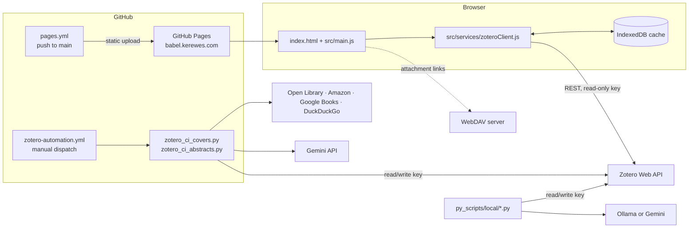

# Babel

A static, cover-first web frontend for browsing a Zotero library, plus Python scripts that enrich the library with
covers, abstracts, tags and metadata. Deployed on GitHub Pages at <https://babel.kerewes.com/>.

## Overview

Babel turns a Zotero library (mainly books) into an image-heavy grid similar to the Zotero web app's library view.
It runs entirely in the browser: plain ES modules call the Zotero Web API directly, with no backend and no build step.

The second half of the repository keeps the library looking good: two scripts run on demand in GitHub Actions to fill
in missing covers and abstracts, and a larger set of local scripts uses an LLM (Ollama or Gemini) for tagging,
metadata cleanup, curation and research reports.

## Features

### Frontend

- Responsive cover grid with lazy loading (`IntersectionObserver`) and a background "covers loading" state.
- Search-as-you-type across titles and creators.
- Collection dropdown, restricted to an allow-list of collection keys (`ALLOWED_COLLECTIONS`).
- Covers taken, in priority order, from a `Book Cover (b64)` note (base64 image), a `Book Cover (Web)` linked
  attachment, or the first image attachment; otherwise a fallback initial.
- Item drawer with Info, Notes, Tags, Attachments and Related tabs, loaded on demand; related items come from Zotero
  `relations`.
- Attachment links can point to a WebDAV server (`WEBDAV_BASE_URL`) instead of the Zotero API.
- Library cache in IndexedDB so repeat visits render quickly.
- Toast messages for API errors and an animated "Library of Babel" loading screen.

### Automation (GitHub Actions)

- `zotero_ci_covers.py`: finds covers for items without one and stores them as a base64 note. Source waterfall:
  manual overrides, Open Library by ISBN, Amazon by ISBN-10, Google Books, Open Library search, then DuckDuckGo
  images. Supports manual cover URLs (including `page:` entries that scrape `og:image`) and a `no-cover` tag that
  makes a manual removal stick.
- `zotero_ci_abstracts.py`: writes missing `abstractNote` fields using web search context and Gemini
  (`gemini-2.0-flash-lite`).

### Local scripts (`py_scripts/local/`)

| Script | Description |
|---|---|
| `zotero_abstracts.py` | Spanish abstracts via Ollama plus search context, saved to `abstractNote` |
| `zotero_tags.py` | 3–6 thematic tags per book via an LLM |
| `zotero_enrich.py` | Tags, genres and keywords via an LLM; links similar items with `dc:relation` |
| `zotero_metadata_fixer.py` | Uses search results and an LLM to fix metadata (split author names, dates, publishers) |
| `zotero_original_dates.py` | Adds the original publication date of classics to `Extra` as `original-date: YYYY` |
| `zotero_images_duckduckgo.py` | Finds covers on DuckDuckGo Images and attaches them as `Book Cover (Web)` links |
| `zotero_images_google_books.py` | Finds covers via the Google Books API and attaches them as links |
| `zotero_covers_to_b64.py` | Downloads linked covers, resizes them and stores them as base64 notes, removing the link |
| `zotero_nobel_winners.py` | Adds a representative book by each Nobel Prize in Literature laureate to a collection |
| `zotero_aquileo.py` | Adds books by winners of Costa Rica's Premio Aquileo J. Echeverría (short story) to a collection |
| `zotero_research_report.py` | Generates research reports for items with Gemini Deep Research |
| `zotero_research_followup.py` | Interactive follow-up questions on active research sessions |
| `zotero_research_autosave.py` | Saves all completed research sessions back to Zotero |

## Architecture



## Requirements

- Frontend: a modern browser and any static file server (ES modules do not load from `file://`).
- Scripts: Python 3.11 (the version CI uses), a Zotero user or group ID and API key; read/write access for anything
  that edits the library.
- Optional: an Ollama server for the local LLM scripts, a Gemini API key for abstracts and research scripts.

## Installation and quick start

Frontend:

```bash
git clone https://github.com/Lapeyus/babel.git
cd babel
# edit src/config.js (see Configuration), then:
python3 -m http.server 8000        # or: npx http-server .
# open http://localhost:8000
```

Scripts:

```bash
cd py_scripts
python3 -m venv .venv
source .venv/bin/activate
pip install -r requirements.txt          # CI scripts
pip install -r local/requirements.txt    # local scripts (adds markdown)
cp .env.example .env                     # then fill in your own values
python zotero_ci_covers.py
python local/zotero_tags.py
```

## Usage

- **Browse**: open the site, pick a collection, type to filter, click a cover for details.
- **Fill covers or abstracts from GitHub**: Actions, *Zotero Automation*, *Run workflow*. Inputs: the script to run,
  optional comma-separated collection keys (overriding the `COLLECTION_KEY` secret) and optional `manual_covers` JSON
  mapping item keys to cover URLs.
- **Local enrichment**: run any script in `py_scripts/local/` with the `.env` in place. Scripts that modify items
  write directly to your Zotero library.

## Repository layout

```text
.
├── index.html                  # page shell
├── src/
│   ├── config.js               # library ID, read-only key, allowed collections, WebDAV URL
│   ├── main.js                 # UI: grid, search, filters, detail drawer, loading animation
│   └── services/zoteroClient.js# Zotero API client: paging, concurrency, cover resolution, IndexedDB cache
├── styles/main.css
├── py_scripts/
│   ├── zotero_ci_covers.py     # CI: cover waterfall -> base64 note
│   ├── zotero_ci_abstracts.py  # CI: abstracts with Gemini
│   ├── requirements.txt
│   ├── .env.example
│   └── local/                  # LLM-based enrichment, curation and research scripts (+ requirements.txt)
├── .github/workflows/
│   ├── pages.yml               # deploy static site to GitHub Pages
│   └── zotero-automation.yml   # manual run of the CI scripts
├── favicon*.png, apple-touch-icon.png
└── LICENSE                     # Apache License 2.0
```

## Configuration

Frontend (`src/config.js`): `LIBRARY_TYPE`, `LIBRARY_ID`, `API_KEY`, `ALLOWED_COLLECTIONS`, `DEFAULT_COLLECTION_ID`,
`PAGE_SIZE`, `WEBDAV_BASE_URL`. Because the site is static, whatever key is in this file is visible to every visitor:
only ever use a **read-only** Zotero key here.

Scripts (environment or `.env`, see `py_scripts/.env.example`): `ZOTERO_USER_ID`, `ZOTERO_API_KEY`, `LIBRARY_TYPE`,
`COLLECTION_KEY`, `TARGET_ITEM_TYPE` (default `book`), `GEMINI_API_KEY`, `MANUAL_COVERS`, and for Ollama
`OLLAMA_URL`, `OLLAMA_MODEL`, `OLLAMA_TIMEOUT`, `OLLAMA_TEMPERATURE`.

GitHub secrets used by the workflows: `ZOTERO_USER_ID`, `ZOTERO_API_KEY`, `COLLECTION_KEY`, `LIBRARY_TYPE`,
`TARGET_ITEM_TYPE`, `GEMINI_API_KEY`.

Not committed: `.env`, virtualenvs and `config.local.js` (ignored, though nothing reads it yet).

## Tests

There is no test suite. Syntax checks pass (27 Oct 2026): `python3 -m py_compile py_scripts/*.py py_scripts/local/*.py`
and `node --check` on the three JavaScript modules.

## Deployment

Every push to `main` runs `pages.yml`, which uploads the repository root as the Pages artifact and deploys it. The
custom domain is `babel.kerewes.com`.

## Project status

Active personal project. Started May 2024 (rebooted October 2025); 46 commits, the latest on 22 July 2026
(background cover-loading state in the grid).

### Known limitations

- The Pages workflow injects `LIBRARY_ID` from secrets with `sed`, but its `API_KEY` substitution is commented out
  (the committed read-only key is what gets deployed) and `COLLECTION_KEY` is commented out in `src/config.js`, so
  that secret has no effect on the site; the frontend uses `ALLOWED_COLLECTIONS` and `DEFAULT_COLLECTION_ID`.
- `py_scripts/local/research_state.json` is tracked even though `py_scripts/.gitignore` lists `*/local/research_state.json`
  (that pattern, relative to `py_scripts/`, does not match `local/research_state.json`).
- Collections outside `ALLOWED_COLLECTIONS` are not shown.
- The DuckDuckGo-based cover search is rate-limited and scrapes a third-party service, so CI runs can be partial.
- The local scripts default to an Ollama cloud model (`minimax-m2:cloud`) in `.env.example`; change `OLLAMA_MODEL` for
  a fully local setup.

## License

Apache License 2.0. See [LICENSE](LICENSE).
